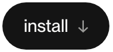
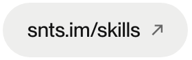
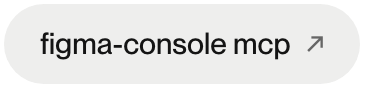
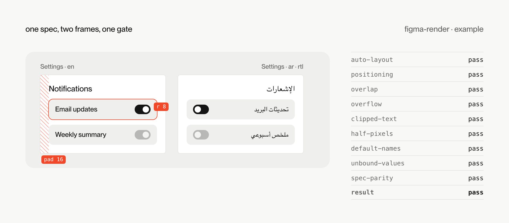
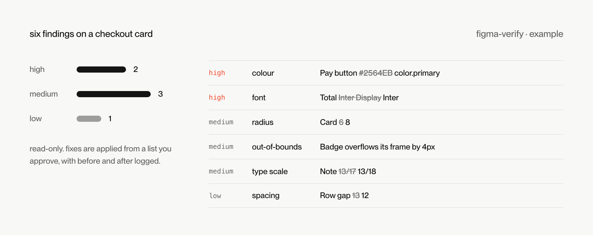

<picture><source media="(prefers-color-scheme: dark)" srcset=".github/banner-dark.png"></picture>

<a href="#install"><picture><source media="(prefers-color-scheme: dark)" srcset=".github/btn-install-dark.png"></picture></a>&nbsp;<a href="https://snts.im/skills"><picture><source media="(prefers-color-scheme: dark)" srcset=".github/btn-site-dark.png"></picture></a>&nbsp;<a href="https://github.com/southleft/figma-console-mcp"><picture><source media="(prefers-color-scheme: dark)" srcset=".github/btn-mcp-dark.png"></picture></a>

two claude code skills i use for designing in figma. one builds screens from a layout spec, the other checks them against your design system. you talk to claude, claude writes the spec or runs the check, and figma does the rest.

&nbsp;

## figma-render

write a layout as json and get the screen in figma. one tested renderer handles the plugin api call order, so nodes land where the spec says, with auto-layout everywhere and every value bound to a variable. after each render a gate runs nine checks and names any node that fails.

<picture><source media="(prefers-color-scheme: dark)" srcset=".github/render-dark.png"></picture>

<sub>illustration of a render and its gate output</sub>

**when you'd reach for it**

- you ask claude for a settings screen and want it built from your components and tokens, not drawn by hand
- you need the same screen in english and arabic, mirrored properly, from one spec
- you're importing design tokens (dtcg resolver format) as figma variables and text styles
- you want hand edits caught: spec-parity fails when the frame no longer matches its spec

<details>
<summary>the spec behind that frame</summary>

```json
{
  "screen": "Settings",
  "size": [390, 240],
  "direction": "ltr",
  "fill": "color.surface",
  "pad": "space.inset.md",
  "gap": "space.stack.sm",
  "children": [
    { "text": "Notifications", "style": "Title/Small" },
    {
      "stack": "Email row", "dir": "row", "justify": "between", "align": "center",
      "w": "fill", "pad": "space.inset.sm", "radius": "radius.md", "fill": "color.surface.raised",
      "children": [
        { "text": "Email updates", "style": "Body/Medium" },
        { "instance": "Switch", "props": { "State": "On" } }
      ]
    }
  ]
}
```

set `"direction": "rtl"` and `"lang": "ar"` for the arabic frame. the renderer mirrors the layout and any icon listed in your mirroring manifest.

</details>

&nbsp;

## figma-verify

checks a figma change against your design system once it's made: colours, radii, borders, fonts, type scale, spacing, and nodes outside their parent's bounds. every finding names the node, what it found and what it expected.

<picture><source media="(prefers-color-scheme: dark)" srcset=".github/verify-dark.png"></picture>

<sub>illustration of a verify report</sub>

**when you'd reach for it**

- claude (or a teammate) just changed a frame and you want to know what drifted from the system
- you're reviewing a file before handoff and want the off-token colours and stray radii in one list
- you want fixes applied from a list you approve, with before and after logged

the palette, radii and font in `references/contract-baseline.md` and the two `CONTRACT` blocks are examples. swap in yours before you trust the results.

&nbsp;

## install

```sh
git clone https://github.com/selfydev/skills
cp -R skills/figma-render skills/figma-verify ~/.claude/skills/
```

restart claude code and both show up in the skills list. then ask for a screen, or ask claude to verify the frame you have selected.

## needs

- figma desktop with the [figma-console mcp](https://github.com/southleft/figma-console-mcp) desktop bridge running, connected to claude code
- node 20 or later for figma-render, no dependencies

## license

mit
