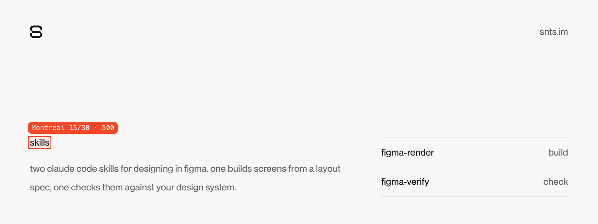

<picture>
  <source media="(prefers-color-scheme: dark)" srcset=".github/banner-dark.png">
  
</picture>

&nbsp;

two claude code skills i use for designing in figma. one builds screens from a layout spec, one checks them against your design system. more on [snts.im/skills](https://snts.im/skills).

&nbsp;

**figma-render** &nbsp; <sub>build</sub>

write a json layout spec and get the screen or component in figma. one tested renderer handles the plugin api call order, so you get auto-layout everywhere, bound variables, component sets and right-to-left mirroring without nodes landing in the wrong place. it also imports design tokens (dtcg resolver format) as figma variables and text styles, then runs a gate after each render that checks for overlap, overflow, clipped text, half pixels, default names and unbound values.

`src/token-values.mjs` holds no tokens of its own, only the rules that map token names to figma scopes and code syntax. bring your own resolver file.

&nbsp;

**figma-verify** &nbsp; <sub>check</sub>

checks a figma change against your design system once it's made: colours, radii, borders, fonts, type scale, and nodes outside their parent's bounds. read-only snippets you run through `figma_execute`, plus one that applies a list of property fixes and logs before and after. the palette, radii and font in `references/contract-baseline.md` and the two `CONTRACT` blocks are examples. swap in yours before you trust the results.

&nbsp;

### install

```sh
git clone https://github.com/selfydev/skills
cp -R skills/figma-render skills/figma-verify ~/.claude/skills/
```

restart claude code and both show up in the skills list.

### needs

- figma desktop with the [figma-console mcp](https://github.com/southleft/figma-console-mcp) desktop bridge running, connected to claude code
- node 20 or later for figma-render, no dependencies

### license

mit
